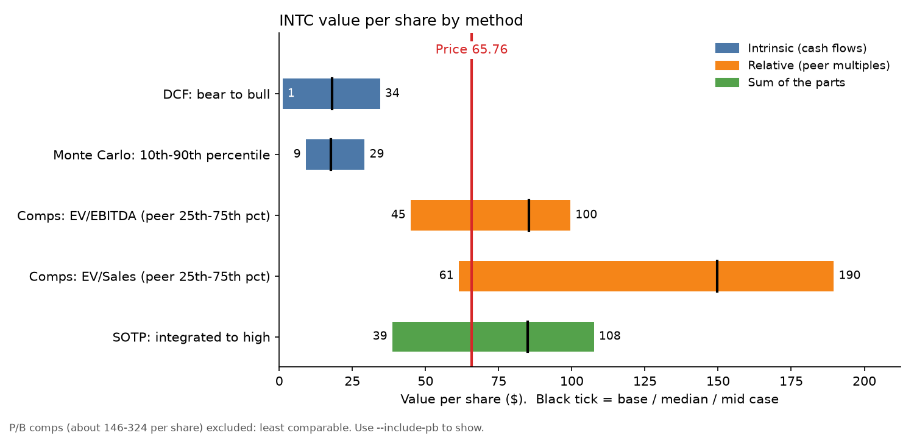

# Intel (INTC) Valuation Model

A scenario-based valuation of Intel Corporation in pure Python: DCF (bear/base/bull) with a reverse DCF, relative valuation against peers, a sum-of-the-parts and a Monte Carlo layer, combined into a football field chart and a short investment memo ([memo.md](memo.md)).

Intel is pretty difficult to value. Free cash flow has been negative because of foundry capex. Earnings are volatile (so P/E cannot be used), and the capital structure has changed recently, including a $23bn equity raise in 2026. The point of the project is to make and defend those judgement calls. It won't produce a "correct" price target, and nothing here is investment advice.

> **Status:** all planned methods are built. The scenario assumptions are still drafts (see Open items), so treat the numbers as work in progress.

## Methods

| Method | Purpose | Status |
|---|---|---|
| Data pipeline (SEC EDGAR, yfinance, FRED) | Reproducible inputs from free sources | Done |
| Historical analysis | Margins, capex intensity, FCF, net debt | Done (pre-2016 revenue gap and pre-2022 net debt open) |
| WACC (CAPM) | Discount rate range from several beta windows | Done |
| Scenario DCF | Bear / base / bull, WACC x g grid, tornado | Done (engine); assumptions under review |
| Reverse DCF | Revenue CAGR, terminal margin and WACC needed to justify the market price | Done |
| Comps | EV/Sales, EV/EBITDA, P/B against peers | Built; scraped data, spot-check |
| Sum-of-the-parts | Intel Products vs Intel Foundry plus corporate costs | Built; multiples are judgements |
| Monte Carlo | Correlated shocks to growth, margin, capex, WACC and terminal growth around the base scenario; fixed seed | Done; spreads are judgements |
| Football field | Ranges from every method against the share price | Done |
| Memo | Thesis, results across methods, what would prove it wrong | Draft: [memo.md](memo.md) |

## Project layout

```
PythonProject1/
├── README.md
├── memo.md                 # thesis, results across methods, falsification signals
├── requirements.txt
├── .gitignore
├── config/
│   └── assumptions.yaml    # scenario assumptions and equity bridge inputs
├── docs/
│   └── football_field.png  # copied from outputs/ for the memo and README
├── src/                    # reusable logic
│   ├── data_loader.py      # SEC / yfinance / FRED pulls, peer snapshot
│   ├── wacc.py             # beta (paired_returns), CAPM, WACC
│   ├── dcf.py              # DCF engine, sensitivity grid
│   ├── reverse_dcf.py      # bisection solvers for implied drivers
│   ├── comps.py            # peer multiples, implied Intel value
│   ├── sotp.py             # segment run-rates, SOTP cases
│   ├── montecarlo.py       # correlated driver shocks, distribution of DCF value
│   └── football_field.py   # tidy table and chart of ranges by method
├── scripts/                # run in order; each prints tables and saves outputs
│   ├── step1_historicals.py
│   ├── step2_wacc.py
│   ├── step3_dcf.py
│   ├── step4_reverse_dcf.py
│   ├── step5_comps.py
│   ├── step6_sotp.py
│   ├── step7_montecarlo.py
│   └── step8_football_field.py
├── tests/
│   ├── test_wacc.py
│   ├── test_dcf.py
│   ├── test_reverse_dcf.py
│   ├── test_comps.py
│   ├── test_sotp.py
│   ├── test_montecarlo.py
│   └── test_football_field.py
├── data/
│   ├── raw/                # cached downloads (gitignored)
│   ├── processed/          # cleaned CSVs derived from public filings
│   └── manual/             # hand-entered inputs: segments.csv
├── knowledge_base/         # notes (financial_terms.md)
└── outputs/                # tables, charts (gitignored; regenerated by the scripts)
```

## How to run

1. Install dependencies: `pip install -r requirements.txt`
2. SEC requires a contact User-Agent. In PowerShell:
   `$env:SEC_USER_AGENT="Your Name your.email@example.com"`
   (macOS/Linux: `export SEC_USER_AGENT="..."`)
3. Pull data: `python src/data_loader.py`
4. Check `data/manual/segments.csv` against the latest 10-Q/10-K segment note (USD millions, source note on every row).
5. Run the scripts in order:
   - `python scripts/step1_historicals.py` - historical tables and chart
   - `python scripts/step2_wacc.py` - beta, cost of equity and WACC by window
   - `python scripts/step3_dcf.py` - three scenarios, sensitivity grid, tornado
   - `python scripts/step4_reverse_dcf.py [--price 65.76]` - what the market price implies
   - `python scripts/step5_comps.py [--refresh]` - peer multiples and implied Intel value
   - `python scripts/step6_sotp.py` - sum-of-the-parts and the Foundry transfer-price sensitivity
   - `python scripts/step7_montecarlo.py [--n 20000 --seed 42]` - distribution of DCF value and P(value > price)
   - `python scripts/step8_football_field.py [--include-pb]` - reads the CSVs saved by steps 3, 5, 6 and 7 and draws the football field
6. Run the tests: `pip install pytest` then `pytest`

To force fresh market data, delete the files in `data/raw/` (or pass `refresh=True` to the loader functions, or `--refresh` to step 5). Cached files never expire on their own (cache expiry is on the to-do list).

## Step-by-step plan

### Phase 0: Setup
1. Create the folder structure and `.gitignore` (`.venv/`, `.idea/`, `__pycache__/`, `data/raw/`, `data/lseg/`, `outputs/`).
2. Run `data_loader.py` and confirm it prints financials, shares outstanding, last close and 10Y yield.
3. Fill in `segments.csv` from the filings.

### Phase 1: Understand the business
4. Run `step1_historicals.py`. Check revenue and operating income against the 10-K for two or three years. Make sure no column is NaN.
5. Reconcile the latest balance sheet against the latest 10-Q (cash, short-term investments, debt, equity, non-controlling interest).
6. Record valuation-date inputs: price, shares outstanding, debt, cash and investments, non-controlling interest.

### Phase 2: Cost of capital
7. Estimate beta by regressing INTC returns on SPY over several windows (2y/3y/5y weekly, 5y monthly), using aligned return windows.
8. Cost of equity by CAPM using the 10Y Treasury yield and Damodaran's implied ERP.
9. Cost of debt as risk-free rate plus a credit spread for Intel's rating (see limitations).
10. Present a WACC range, not a single number, and cross-check against Yahoo's beta and an industry beta relevered at Intel's leverage.

### Phase 3: DCF
11. `assumptions.yaml` holds bear/base/bull scenarios (revenue growth, EBIT margin path, D&A, capex, tax rate, terminal growth). FY2026 year-1 growth is anchored to nine-month reported revenue plus the Q4 guidance range. Each scenario should carry a written rationale before the output is read (see scenario rationale).
12. `dcf.py` is unit tested against hand-calculated cases.
13. Run the three scenarios, a WACC vs terminal growth grid, and a tornado chart.
14. Sanity checks: terminal value share of EV, implied exit multiple, terminal growth below the risk-free rate, **terminal capex at least D&A** (the engine warns if not).
15. Equity bridge: EV plus cash and short-term investments, minus debt, minus non-controlling interest, divided by shares outstanding.
16. Reverse DCF: solve for the revenue CAGR, terminal EBIT margin and WACC that equate DCF value to the market price. Assumptions are never tuned to hit the price.

### Phase 4: Comps and SOTP
17. Comps: EV/Sales, EV/EBITDA and P/B for the peer group, with a consistency screen (EV/market cap) that excludes rows with mixed currencies. Peer median and quartiles applied to Intel, through the same equity bridge as the DCF.
18. SOTP: Intel Products valued on EV/EBIT against fabless peers, Intel Foundry on EV/Sales against GlobalFoundries, All Other at a discount, corporate costs capitalised. Segment revenues overlap (Foundry sells mostly to Products), so they are never added. A sensitivity shows how much of Foundry's loss is charged to Products.

### Phase 5: Monte Carlo
19. Shock growth, terminal margin, capex, WACC and terminal growth around the base scenario with fixed correlations and a fixed seed (20,000 draws). Report percentiles and the probability of value exceeding the current price and should then test how much the answer depends on the spreads and the centre (bear/base/bull, spreads x1 and x2).

### Phase 6: Synthesis
20. Football field chart across the methods, built from the CSVs the earlier steps save (nothing is recomputed).
21. `memo.md`: thesis, what the price implies, why the methods disagree, what would prove it wrong, key judgements and data caveats.
22. Run every script from a clean checkout and commit per phase.

## Data sources and as-of dates

| Input | Source | As of |
|---|---|---|
| Financial statements | SEC EDGAR XBRL company facts | FY2025 10-K |
| Latest balance sheet | SEC EDGAR, tied to the Q3 2026 results release | 30 Oct 2026 |
| Segment results | Intel 10-Q, Note 2 (Operating Segments) | Q3 2026 (quarter ended 26 Sep 2026) |
| Shares outstanding | 10-Q cover page: 5,315m (5,310m at 26 Sep 2026) | late Oct 2026 |
| Share price | yfinance (scraped; spot-check before use): 65.76 | 30 Oct 2026, after Q3 results |
| Risk-free rate | FRED DGS10: 4.98% | *confirm date of the cached file* |
| Equity risk premium | Damodaran implied ERP: 4.20% | 1 Oct 2026 (check for update) |
| Credit spread | Damodaran BBB spread table: 1.11% (table undated) | confirm Moody's level and any post-Q3 action |
| Peer multiples | yfinance (scraped; trailing; spot-check before use) | *update on refresh* |

*Update the market-data rows each time the caches are refreshed.*

### Balance sheet tie-out (Q3 2026, USD millions)

| Item | Value | Note |
|---|---|---|
| Cash and equivalents | 21,846 | |
| Short-term investments | 32,159 | equals `afs_investments` |
| Total debt | 50,134 | 3,817 short-term + 46,317 long-term |
| Non-controlling interest | 16,642 | book value |
| Intel stockholders' equity | 114,914 | 131,556 including NCI; loader `total_equity` excludes NCI |
| Shares outstanding | 5,315m | |

The $23bn equity raise (22.6bn net) explains the jump in liquidity.

### WACC

Inputs: risk-free 4.98%, ERP 4.20%, cost of debt = risk-free + 1.11%.

| Beta window | Beta |
|---|---|
| 2y weekly | 2.10 |
| 3y weekly | 2.15 |
| 5y weekly | 1.63 |
| 5y monthly | 2.42 |

The WACC range across windows is 10.9-13.8%. The base case uses **11.5%**, consistent with a Blume-adjusted beta of about 1.7-1.8.

## Results so far

### DCF

WACC 11.5%. FY2026 year-1 growth is anchored to nine-month reported revenue plus the Q4 guidance range, and D&A fades below terminal capex in all three scenarios.

| Scenario | Value per share | vs 65.76 |
|---|---|---|
| Bear | 1.14 | -98% |
| Base | 18.09 | -72% |
| Bull | 34.46 | -48% |

Even the bull case is well below the market price, so the market EV (about 362bn) requires far more than any scenario assumes.

### Reverse DCF: what it takes to reach 65.76

One driver at a time, everything else at the scenario:

| Driver | Base as modelled | Needed for 65.76 | Bull needed |
|---|---|---|---|
| Revenue CAGR, 10 years | 7.3% (107bn in year 10) | 24.4% (469bn in year 10) | 18.7% |
| Year-10 EBIT margin | 20% | 69% | 54% |
| WACC | 11.5% | 5.7% | 8.0% |

Year-10 revenue of 469bn is about six times Intel's 2021 revenue. Combinations: at a 15% revenue CAGR the year-10 margin must reach about 40%; at 20% about 28%; at 25% about 21%. The bear case has no realistic solution (its 50% CAGR and 3.0% WACC roots are mathematical, not plausible scenarios).

### Comps

Intel trades below the peer median on every multiple: EV/Sales 6.0x vs 13.5x, EV/EBITDA 18.9x vs 24.4x, P/B 3.0x vs 12.3x (seven peers; TSM excluded for mixed-currency data). Peer-implied values per share are about 150 (EV/Sales), 85 (EV/EBITDA) and 265 (P/B), but the peers are priced on AI-era growth and margins Intel does not have, and P/B is the least comparable.

### Sum-of-the-parts

| Case | Value per share |
|---|---|
| Low | 74.92 |
| Mid | 85.03 |
| High | 107.57 |
| Integrated (Products carries all of Foundry's loss) | 38.66 |

The result turns on how much of Foundry's loss is really Intel Products' wafer cost. The mid case equals the market price when about half of Foundry's loss is charged to Products.

### Monte Carlo

20,000 draws around the base scenario (1 sd: growth 2pt, year-10 margin 5pt, capex 1.5pt, WACC 1pt, terminal growth 0.5pt; growth-margin correlation 0.5).

| Percentile | 5th | 25th | 50th | 75th | 95th |
|---|---|---|---|---|---|
| Value per share | 7.1 | 12.8 | 17.7 | 23.3 | 33.2 |

P(value > 65.76) = 0.00%: the highest draw is 64.3. Margin drives most of the spread (rank correlation +0.88), then growth (+0.62), WACC (-0.34) and capex (-0.22).

| Centre | Spreads x1 | Spreads x2 |
|---|---|---|
| Bear | 0.00% | 0.07% |
| Base | 0.00% | 2.66% |
| Bull | 1.40% | 11.85% |

There is little to no possibility of beating the price, unless the draws are centred on the bull case and every uncertainty is doubled.

### Football field



Every cash-flow range ends below 35 per share; every peer-based range spans the 65.76 price. P/B comps are left off as the least comparable.

### Reading across methods

The DCF, which values Intel on its own cash flows, sits far below the market. Peer-multiple methods sit at or above it, because peers are priced for similar growth. The market price is therefore consistent with peer-parity and a margin-recovery story, and inconsistent with any single plausible set of standalone cash flows. Monte Carlo suggests this too. Uncertainty within the DCF framework does not bridge the gap, so the price depends on something the model has no input for. The full argument, and what would prove it wrong, is in [memo.md](memo.md).

## Scenario rationale

Basis: **G** = guidance or reported figures, **H** = bounded by Intel's 2016-2025 history (`step1_historicals.py`), **J** = judgement with no external anchor. Paths were set before the reverse DCF was run; they are not tuned to the price.

| Input | Bear | Base | Bull | Basis |
|---|---|---|---|---|
| FY2026 growth | 15.8% | 16.8% | 17.7% | **G**: nine-month revenue 46,218 + Q4 guide 15.0 / 15.5 / 16.0bn, over FY2025 52,853 |
| FY2026 EBIT margin | 3% | 5% | 7% | **G/J**: nine-month margin about 2.6%. Base implies a Q4 margin of about 12% vs 15.3% in Q3 (slightly conservative); bear about 4%; bull about 20% |
| Growth, years 2-10 | 5% fading to 2.5% | 10% fading to 3.5% | 14% fading to 4% | **J**: fades toward terminal growth. Year-10 revenue about 81bn / 107bn / 130bn vs the 2021 peak of 79bn (**H**) |
| EBIT margin, year 10 | 11% | 20% | 26% | **H/J**: 2016-21 range 22-33% (average 28%); 2022-25 range -22% to 4%. Bear is half the pre-2022 floor, base slightly below it, bull below the pre-2022 average |
| Margin ramp | 3% to 11% | 5% to 20% by year 7 | 7% to 26% by year 7 | **J**: the speed of recovery has no anchor |
| D&A / revenue | 18% fading to 13% (all scenarios) | | | **H**: terminal 13% matches 2016-18; year 1 is below FY2025's 22.1%, which is conservative for FCF |
| Capex / revenue, year 1 | 28% | 27% | 25% | **H**: FY2025 was 27.7% |
| Capex / revenue, terminal | 16% | 14% | 14% | **H**: pre-2022 range was 16-24%, so base and bull are below any year on record. Check against net PP&E |
| Terminal growth | 2.0% | 2.5% | 3.0% | **J**: all below the 4.98% risk-free rate |
| Tax rate | 18% (all) | | | **Unsourced**: check against the 10-K tax note |
| NWC | 10% of change in revenue (all) | | | **J** |

## Open items

- **Tax rate.** The 18% rate is unsourced; check it against the 10-K tax note, or flag it as judgement, and consider a 15% / 18% / 21% sensitivity.
- **Terminal reinvestment check.** Terminal capex of 14% of revenue is below every year on record (pre-2022 range 16-24%). Compare implied net PP&E / revenue with the actual balance sheet figure.
- **Year-1 EBIT margins** (3% / 5% / 7%) to be confirmed against Q4 2026 results.
- Tornado capex bar overstates the upside (lower capex without lower D&A); fade D&A with it.
- Equity stakes (e.g. Altera) are not yet valued in the SOTP.
- Pre-2016 revenue tag (`SalesRevenueNet`); pre-2022 net debt reconciliation.
- Cache expiry for `data/raw/`.
- Confirm the comps and SOTP figures above against a fresh run of steps 5 and 6 before committing.
## Limitations

- Cost of debt uses a generic BBB spread rather than Intel's own traded yields.
- Pre-2016 revenue uses a different XBRL tag; pre-2022 net debt is not reconciled.
- Reverse DCF: bear-case solutions (50% revenue CAGR, 3.0% WACC) are mathematical roots, not plausible scenarios. The CAGR solve also applies one growth rate to every year, including FY2026, which is already largely known.
- SOTP: Foundry revenue is mostly intersegment, so segment revenues overlap. Products' margin depends on internal transfer prices; the share of Foundry's loss charged to Products is the key judgement. Every multiple is set at the top of `step6_sotp.py`. Corporate costs use the Q3 run-rate; the nine-month figure is much larger and may include one-off items.
- Monte Carlo: spreads and correlations are judgements, not fitted to the price. The engine does not floor equity at zero, so bear-case percentiles can be negative. The result measures uncertainty within the DCF framework only.
- Peer data comes from yfinance (scraped, trailing, mixed fiscal year-ends); the operating margin field may not match its revenue period, and TSM is excluded because its row mixes currencies. Spot-check before quoting.