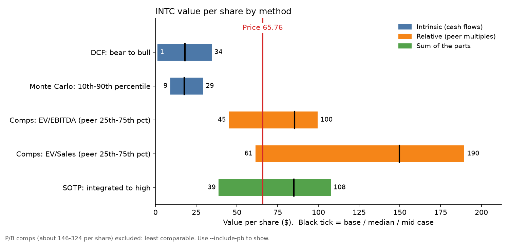

# INTC valuation memo

18 Nov 2026

## Summary

Intel's share price of 65.76 is not supported by its own cash flows under any plausible assumptions. Only peer-parity multiples, or a margin-recovery story the model has no input for, get there.

- **Standalone cash flows:** the DCF at an 11.5% WACC gives 1.14 / 18.09 / 34.46 (bear/base/bull) per share. None of the 20,000 Monte Carlo draws around the base case exceeds the price, and the highest is 64.3.
- **What the price means:** the base case would need a 24.4% revenue CAGR for ten years (469bn in year 10, which is about six times Intel's 2021 revenue of about 79bn), or a 69% EBIT margin, or a 5.7% WACC.
- **Peer multiples:** Intel trades below the peer median on EV/Sales, EV/EBITDA and P/B. The EV/EBITDA-implied value is around 85 per share, and this is the same for the sum-of-the-parts mid case.
- **The gap:** peers are priced for growth and margins Intel does not have today, so the market is paying Intel for recovery in Foundry for the most part. The mid SOTP case equals the price when about half of Foundry's loss is charged to Intel Products.

This memo reports what the models show. It's not a recommendation to buy or sell.

## What the market price implies

At 65.76 the market is pricing roughly 24% annual revenue growth for ten years, or a 69% operating margin. There isn't a single driver within a plausible range that closes the gap.

Each row solves for one driver with everything else held at the scenario.

| Driver | Base as modelled | Needed for 65.76 | Bull needed |
| --- | --- | --- | --- |
| Revenue CAGR, 10 years | 7.3% (107bn in year 10) | 24.4% (469bn in year 10) | 18.7% |
| Year-10 EBIT margin | 20% | 69% | 54% |
| WACC | 11.5% | 5.7% | 8.0% |

Combinations are less extreme but still demanding: at a 15% revenue CAGR the year-10 margin must reach about 40%, at 20% about 28%, at 25% about 21%. A 5.7% WACC sits 0.7 points above the 4.98% risk-free rate, which would mean almost no equity risk for a stock with betas of 1.6 to 2.4. The bear case has no realistic solution.

## Valuation by method

Every cash-flow range ends below 35 per share; every peer-based range spans the 65.76 price.

*Model outputs from project steps 3, 5, 6 and 7 · 18 Nov 2026 · price is the 30 Oct 2026 close*

The sum-of-the-parts range runs from the integrated case (Products carries all of Foundry's loss) to the high case, with the mid case as the dot. Comps use the peer 25th to 75th percentile, so one extreme peer cannot stretch a range.

## Why the methods disagree

The cash-flow methods and the peer-based methods disagree because peers are priced for growth and margins that Intel's standalone forecasts don't have.

- **Peers are a different business today.** In the snapshot, peer median multiples are 13.5x EV/Sales and 24.4x EV/EBITDA, against Intel's 6.0x and 18.9x. Peer operating margins run from about 10% to 81%, against Intel's 16%. This means a sales multiple flatters Intel, and P/B (peer median 12.3x) is the least comparable.
- **Intel's segments overlap.** Foundry revenue of about 24bn a year (nine-month figure annualised) is mostly Intel Products buying wafers. Only about 1.2bn is external. Foundry loses about 8.5bn a year, while Products earns about 19bn ([Intel 10-Q, quarter ended 26 Sep 2026](https://www.sec.gov/Archives/edgar/data/0000050863/000005086326000191/intc-20260926.htm)).
- **The transfer price decides the answer.** Products' margin is struck after paying Foundry's internal prices. If those prices are below Foundry's cost, Products' profit is flattered, so part of Foundry's loss actually belongs to Products.

Value per share in the sum-of-the-parts mid case, by the share of Foundry's loss charged to Products (Products valued at the 24.5x peer median EV/EBIT):

| Foundry loss charged to Products | Value per share |
| --- | --- |
| 0% | 85 |
| 25% | 75 |
| 50% | 66 |
| 75% | 56 |
| 100% | 46 |

The market price of 65.76 corresponds to charging Products about 49% of Foundry's loss. That is a judgement, not a measurement. It's the one the memo can't resolve from public filings.

## What would prove this wrong

No margin or growth outcome inside the modelled ranges reaches 65.76 (the highest of 20,000 draws is 64.3), so this memo can only be wrong if Intel's business changes. These are the signals to look out for.

| Signal | Latest | Base case assumes | Would mean the memo is too low |
| --- | --- | --- | --- |
| Revenue growth, FY2027 | FY2026 about 17% (nine months reported plus Q4 guide of 15-16bn) | 10% | Above 20%; the price path needs about 25% |
| GAAP operating margin | Q3 2026 15.3%; nine months 2.6% | 9% in FY2027 | At or above 15% for four quarters in a row |
| Foundry operating loss | -1,853m in Q3 2026 | Not modelled separately | Better than -1,000m a quarter for two quarters in a row |
| Foundry external revenue | 411m in Q3 2026 (878m for nine months) | Not modelled separately | Above 1,000m a quarter |

The thresholds in the last column are more like proposals rather than model outputs. One check on the margin signal: in the tornado, 3 points of EBIT margin moves the base case by about 4.3 per share, so even a margin that stays above 15% would not close the gap on its own.

The opposite test also applies. If revenue growth stays near the base case's 10% while the share price holds, the price is resting on peer-parity alone, and a peer re-rating would move Intel's price regardless of its own results.

## Key assumptions and judgements

Five judgements move the answer most. They sit in `assumptions.yaml` or at the top of the step scripts. Year-1 growth is anchored to guidance; the paths for years 2-10 are judgements bounded by Intel’s 2016-2025 history and were set before the reverse DCF was run (see the README’s scenario rationale).

- **WACC of 11.5%.** The range across beta windows is 10.9-13.8%. In the tornado, 1.5 points either way moves the base case from 14.4 to 23.4 per share.
- **EBIT margin path.** The base case reaches 20% by year 7. Three points either way moves value by about 4.3 per share. It's the second-largest swing in the tornado.
- **Terminal reinvestment.** Terminal capex is 14% of revenue against 13% D&A, and terminal value is 60% of base EV. Intel's actual net PP&E relative to revenue has not been checked against this, so the base case could still be too generous.
- **Equity bridge.** Non-controlling interest (16.6bn) is held at book value; fab joint-venture stakes might be worth more. Doubling it lowers the base case by about 3.1 per share.
- **Multiples in the sum-of-the-parts.** Products at 22-33x EBIT (QCOM, NVDA, AVGO; AMD excluded as an outlier above 60x), corporate costs at 10x, Foundry at half of GlobalFoundries' 3.2x EV/Sales, and the share of Foundry's loss charged to Products.

The Monte Carlo spreads (growth 2 points, year-10 margin 5 points, capex 1.5, WACC 1, terminal growth 0.5) are also judgements. Doubling all of them still gives only a 2.7% chance of beating the price around the base case.

## Data caveats and open items

The peer-based results are the least solid part of the memo, because they rest on scraped market data.

- **Peer data is yfinance, trailing and unaudited.** Fiscal year-ends differ, and the operating-margin field may not match its revenue period. TSM is excluded because its row mixes currencies. Should spot-check before quoting any peer multiple.
- **The share price of 65.76 is the 30 Oct 2026 close**, after the Q3 results.
- **Corporate costs.** The nine-month figure (-7.6bn) is much larger than the Q3 run-rate (-1.1bn); the sum-of-the-parts uses the Q3 run-rate. The nine-month figure could include one-off items to check in the 10-Q.
- **Not yet valued:** equity stakes such as Altera, and any fab joint-venture upside beyond book value.
- **Still to fill or confirm:** capex funded through partner arrangements (financing section of the cash flow statement, FY2024 and FY2025 10-Ks), FY2025 revenue of 52,853, year-1 EBIT margins, and Intel's current credit ratings.
- **Net PP&E check** on terminal reinvestment, as noted above.

**Sources**

- [Intel 10-Q for the quarter ended 26 Sep 2026](https://www.sec.gov/Archives/edgar/data/0000050863/000005086326000191/intc-20260926.htm): segment results (Note 2).
- [Intel third-quarter 2026 results release](https://www.intc.com/news-events/press-releases/detail/1786/intel-reports-third-quarter-2026-financial-results): segment results and Q4 revenue guidance of 15.0-16.0bn.
- Model outputs from the project's step scripts (DCF, reverse DCF, comps, SOTP, Monte Carlo), run 16-18 Nov 2026. Risk-free rate from FRED (DGS10), equity risk premium from Damodaran, peer data from yfinance.